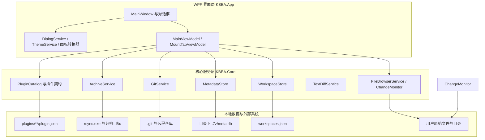

# 知识库自进化助手（KBEA）技术架构与功能逻辑

> 文档版本：v1.0  
> 对应工程版本：开源版 v0.2.0  
> 适用代码库：`https://github.com/7zthinking/rsiKB`  
> 编写依据：当前工作区实际代码，而非设计文档中的目标能力清单。

## 1. 文档目的

本文说明当前开源工程的系统分层、模块职责、核心数据模型、主要业务流程、持久化格式、构建发布方式以及已知的实现边界，供后续开发、测试和二次开发使用。

当前产品定位为 **Windows 本地优先的资料组织与文件浏览工具**。工作空间是资料入口的逻辑集合；物理文件仍保留在原始目录中。Git、rsync、SQLite 元数据和插件接口围绕这些目录提供辅助能力。

## 2. 技术栈与运行环境

| 类别 | 当前实现 |
|---|---|
| 桌面框架 | WPF，`.NET 8`，目标框架 `net8.0-windows` |
| 核心库 | `.NET 8`，目标框架 `net8.0` |
| 界面模式 | MVVM，CommunityToolkit.Mvvm 8.4.0 |
| 依赖注入 | Microsoft.Extensions.DependencyInjection 8.0.1 |
| Git | LibGit2Sharp 0.31.0 |
| 本地数据库 | Microsoft.Data.Sqlite 8.0.11，SQLite WAL 与 FTS5 |
| 文本差异 | DiffPlex 1.7.2 |
| 配置序列化 | System.Text.Json |
| 文件监听 | FileSystemWatcher + Timer 防抖 |
| 归档外部进程 | 用户提供的 Windows 便携版 `rsync.exe` |
| 系统图标 | Windows Shell `SHGetFileInfo`，带内存缓存 |
| 测试 | xUnit 核心／集成测试，Windows UI Automation 界面冒烟测试 |
| 持续集成 | GitHub Actions，Windows x64 构建、测试、打包与 Release 附件上传 |

程序当前依赖 Windows 桌面 API、Shell 图标和 WPF，不支持跨平台桌面运行。

## 3. 总体架构

系统采用“界面层 + 核心服务层 + 文件与数据存储”的轻量分层结构，不依赖服务端，也不要求闭源组件。



### 3.1 依赖方向

- `KBEA.App` 引用 `KBEA.Core`；核心层不引用 WPF。
- 界面通过 ViewModel 调用核心服务，文件列表、状态和命令使用数据绑定。
- 对话框通过 `IDialogService` 隔离，主 ViewModel 不直接创建大多数窗口。
- 轻量单程序集发布会将 `KBEA.Core` 源码编译进 `KBEA.App`，但逻辑分层不变。
- 核心业务类目前多为具体类单例注入，尚未全面接口化；对话框服务是主要接口抽象点。

## 4. 工程结构

```text
rsiKB/
├─ src/
│  ├─ KBEA.App/
│  │  ├─ App.xaml / App.xaml.cs          应用启动、依赖注入、主题初始化
│  │  ├─ MainWindow.xaml(.cs)            主窗口、标签栏、侧栏、浏览与事件适配
│  │  ├─ ViewModels/
│  │  │  ├─ MainViewModel.cs             全局状态与工作空间、Git、远程目录协调
│  │  │  ├─ MountTabViewModel.cs         单个浏览标签的导航、列表、预览与仓库状态
│  │  │  ├─ TreeNodeViewModel.cs         工作空间树节点
│  │  │  └─ LocalFolderViewModel.cs      本地目录懒加载节点
│  │  ├─ Views/                          新建空间、Git、设置、历史等窗口
│  │  ├─ Services/                       对话框与主题服务
│  │  ├─ Converters/                     系统图标与可见性转换器
│  │  └─ Assets/                         应用 Logo 等资源
│  └─ KBEA.Core/
│     ├─ Models/WorkspaceModels.cs       配置、空间、目录、远程位置等模型
│     ├─ Files/                          文件浏览、搜索、文本读取与变更监听
│     ├─ Storage/                        JSON 配置与 SQLite 元数据
│     ├─ Git/GitService.cs               仓库发现、绑定、提交、推送、拉取与历史
│     ├─ Archive/ArchiveService.cs       rsync 子进程归档
│     ├─ Diff/TextDiffService.cs         双栏文本差异模型
│     └─ Plugins/PluginContracts.cs      插件清单与能力接口
├─ tests/KBEA.Tests/                     核心及集成测试
├─ eng/                                  本地 SDK 与界面验证脚本
├─ plugins/                              可选插件清单目录
├─ artifacts/                            本地构建、签名及测试输出
├─ publish.ps1                           自包含绿色版发布
├─ run-light.bat                         轻量运行入口
└─ sign.bat                              轻量版 EXE、DLL 本地签名
```

## 5. 启动与依赖注入流程

`App.OnStartup` 是应用组合根，执行顺序如下：

1. 解析命令行 `--config`；若提供，则使用指定 JSON 配置文件。
2. 注册 `WorkspaceStore`、`FileBrowserService`、`GitService`、`ArchiveService`、`PluginCatalog` 等单例。
3. 注册 `IDialogService -> DialogService`、`MainViewModel` 和 `MainWindow`。
4. 创建 `MainViewModel`，构造时加载配置、迁移远程位置、重建树、发现插件并初始化已有挂载目录元数据。
5. 根据配置应用亮色或暗色主题。
6. 创建并显示默认最大化的主窗口。
7. 解析 `--open`；若目标目录存在，则打开本地浏览标签。
8. 退出时释放 ViewModel、文件监听器和依赖注入容器。

支持的启动参数：

```powershell
KBEA.exe --config "D:\KBEA-Config\workspaces.json" --open "D:\资料"
```

两个参数均可独立使用。`--open` 指向不存在的目录时不会创建标签。

## 6. 界面与交互架构

### 6.1 主窗口区域

主窗口由三部分组成：

1. **合并顶栏**：Logo、应用名、版本、可拖动排序的标签、新建标签、主题、设置和窗口控制按钮。
2. **主内容区**：可收起左侧栏、分隔拖动条和当前浏览／编目视图。
3. **状态栏**：全局操作状态、当前仓库状态、同步时间和监听模式。

侧栏包含“工作空间、本地目录、远程目录”三个主分类。当前高亮和主按钮使用橙色主题；列表及树节点具备悬停、选中状态，目录单击打开，文件双击调用系统默认程序。

### 6.2 多标签模型

每个标签对应一个 `MountTabViewModel`，独立保存：

- 当前路径、根路径、地址栏文本；
- 后退与前进栈；
- 当前文件列表和选中项；
- 搜索词与预览状态；
- 当前目录实际发现的 Git 仓库根和状态；
- 本地浏览或工作空间挂载上下文。

点击“＋”或按 `Ctrl+T` 固定创建“我的电脑”标签，列出可用驱动器，不继承上一个标签路径。标签支持拖动调整顺序，不支持拖出成为独立窗口。

### 6.3 导航规则

- 地址栏接受真实目录或“我的电脑”虚拟视图。
- 本地标签跨驱动器导航时会更新根路径。
- 工作空间挂载标签限制在挂载根目录内，地址栏不能跳出该根目录。
- 后退、前进使用两个栈；发生新导航时清空前进栈。
- 本地驱动器根目录继续向上会回到“我的电脑”。
- 目录单击选中或从侧栏打开，文件列表双击打开目录；文件双击交给 Windows Shell。
- 列表隐藏 `.git/` 和 `.7z/`，避免内部数据混入普通浏览。

## 7. 工作空间与目录逻辑

### 7.1 工作空间的含义

`WorkspaceDefinition` 是逻辑组织单元，包含：

- 唯一 `Id` 与显示名称；
- 多个 `MountDefinition` 资料目录；
- 多级 `CategoryNode` 编目分类；
- 历史遗留的空间级收藏字段。

工作空间不是新的物理目录，不复制文件。一个物理目录当前只能全局挂接一次，重复挂接会被拒绝。

### 7.2 新建工作空间

新建面板要求“名称”和“文件夹位置”同时有效：

1. 用户可直接输入名称。
2. 选择文件夹时，仅当名称为空，才把文件夹名带入名称框。
3. 用户已填写名称后，重新选择文件夹不会覆盖名称。
4. 名称为空或路径不存在时，“新建空间”按钮禁用。
5. 面板可查看当前目录的实际仓库信息，或初始化／关联 Git。
6. 确认后先保存工作空间，再挂接所选目录、初始化 `.7z` 并建立文件索引。
7. 若目录已被挂接，则拒绝创建，避免留下重复或空空间。

### 7.3 工作空间底部工具栏

- **目录**：选择并挂接一个已有物理文件夹；不会在磁盘上新建空目录。
- **空间**：打开新建工作空间面板。
- **删除**：未选节点时禁用；根据节点类型分派删除逻辑。

删除规则：

| 节点 | 行为 |
|---|---|
| 工作空间 | 二次确认后关闭相关标签、停止监听、删除空间配置，并递归删除各关联目录下的 `.7z/`；不删除其他资料文件 |
| 挂载目录 | 二次确认后仅解除组织关系，保留物理目录、`.git/` 和 `.7z/` |
| 编目分类 | 删除该分类节点，其子分类插入到原节点位置，即向上一级提升；不删除磁盘文件 |

工作空间名称可通过节点上的编辑按钮修改。删除 `.7z/` 遇到占用或权限错误时中止删除并提示，不静默忽略。

## 8. 本地目录、收藏与最近访问

### 8.1 本地目录分组

- **常用位置**：主文件夹、桌面、下载、文档、图片、音乐、视频；仅显示实际存在的目录。
- **最近访问**：保存最近打开的本地目录，最多 12 条，侧栏显示前 8 条；启动时过滤已不存在的目录。
- **我的电脑**：列出就绪驱动器，展开时按需读取子目录。

三个分组可独立折叠。目录树采用占位节点 + 首次展开加载，避免启动时递归扫描整个磁盘。

### 8.2 收藏

收藏对象是“当前浏览的物理文件夹”，不是某个文件或“我的电脑”虚拟路径。收藏列表保存在全局配置中；打开收藏时：

- 若路径属于已挂接目录，则打开对应工作空间标签并导航到该子目录。
- 否则按普通本地目录打开。

## 9. 文件浏览、搜索与预览

### 9.1 文件列表

`FileBrowserService.GetEntries` 只读取当前层级：

1. 枚举目录，再枚举文件；
2. 排除 `.git/` 与 `.7z/`；
3. 生成相对路径、大小、修改时间等 `FileEntry`；
4. 目录优先，再按当前区域文化的名称排序。

权限和 I/O 异常不会使整个应用退出，而是返回已能读取的结果。

### 9.2 搜索

搜索实现取决于标签类型：

| 标签类型 | 搜索方式 | 上限 |
|---|---|---|
| 工作空间挂载目录 | 查询 `.7z/meta.db` 中的 FTS5 文件索引 | 200 条 |
| 普通本地目录 | 从当前目录实时递归匹配文件／目录名 | 500 条 |
| 我的电脑 | 不执行内容搜索，恢复驱动器列表 | — |

本地实时搜索跳过 `.git/`、`.7z/` 和重解析点，以减少循环及无关扫描。工作空间 FTS 查询对输入分词并加引号，限制为名称、相对路径和扩展名索引，不是全文内容搜索。

清空搜索词会刷新当前目录。

### 9.3 预览

- 支持常见文本扩展名及 `png/jpg/jpeg/bmp/gif/webp` 图片。
- 文本最大读取 256 KiB；较大文件只显示提示。
- 检测前 8000 字节中的 NUL，识别为二进制时停止文本预览。
- 文本优先严格 UTF-8，失败后使用系统默认编码。
- 其他格式使用系统默认程序打开，不做内置解析。
- 预览面板可折叠。

## 10. 配置与元数据持久化

### 10.1 全局配置

默认位置：

```text
%AppData%\KBEA\workspaces.json
```

主要保存：

- Git 提交署名；
- 主题与自动检测开关；
- rsync 可执行文件路径和归档根目录；
- 收藏、最近访问；
- 已保存远程位置；
- 工作空间、挂载目录和分类树。

`WorkspaceStore` 使用进程内锁保护读写。保存时先写 `.tmp`，再覆盖移动，降低半写文件风险。JSON 损坏时保留 `.broken-yyyyMMddHHmmss` 备份并重建空配置。启动时会清理早期版本生成的特定空“默认工作空间”。

### 10.2 目录级 `.7z` 元数据

挂接目录时创建隐藏目录：

```text
<挂载目录>\.7z\
├─ meta.db
├─ index\
├─ catalog\
├─ lock\
└─ assistant\
```

`meta.db` 使用 SQLite，连接池关闭，WAL 模式。当前表结构：

| 表 | 用途 |
|---|---|
| `catalog_links` | 工作空间、分类、相对路径和 SHA-256 文件指纹的编目关系 |
| `file_index` | 相对路径、名称、扩展名、大小、修改时间 |
| `file_fts` | 文件名、相对路径、扩展名的 FTS5 索引 |
| `archive_nodes` | rsync 关键节点历史 |
| `sync_logs` | Git／同步操作成功或失败日志 |
| `settings` | 目录级键值配置，例如 `git.remote` |

文件索引重建在事务中先清空再逐文件写入；扫描跳过 `.git/` 和 `.7z/`。编目时计算文件 SHA-256，同一“空间 + 分类 + 相对路径”重复编入会更新指纹而非新增重复行。

### 10.3 Git 忽略规则

初始化元数据时会向挂载目录 `.gitignore` 追加缺失规则，包括 `.7z/`、临时文件、系统缩略图以及部分空间数据格式。此操作会修改用户目录中的 `.gitignore`，属于当前明确的产品行为。

编目快照输出到：

```text
.7z\catalog\<WorkspaceId>.json
```

当前新建空间界面不再提供分类创建入口，但核心模型、SQLite 编目和快照能力仍保留，可服务后续界面迭代。

## 11. Git 功能逻辑

### 11.1 仓库发现原则

Git 状态完全由当前浏览目录决定：

```text
当前目录 -> Repository.Discover -> 实际工作树根 -> 读取状态和远程地址
```

全局配置中的“已保存远程位置”只是快捷入口和连接记录，不参与仓库发现，也不会让普通目录被误判为仓库。

因此，打开仓库的任意子目录都能激活当前仓库操作；无仓库目录禁用拉取、上传和历史。

### 11.2 信息与关联面板

- 已有仓库：显示实际根目录、当前分支、未提交变更数、冲突数和远程地址。
- 远程读取优先使用 `origin`，不存在时回退到第一个远程，避免已有其他远程名称时显示为空。
- 修改连接需主动点击“修改仓库连接”，再保存。
- 非仓库：允许选择目录、输入远程地址并确认关联。
- 关联不存在的仓库时执行 `Repository.Init`，保留已有文件。
- 关联操作确保默认分支为 `main`，设置 `origin` 远程，并写目录级 `git.remote` 配置。
- 若面板选择了其他目录，关联后打开该目录。

### 11.3 拉取

1. 打开当前实际仓库。
2. 要求存在 `origin`，且已有本地提交。
3. 将当前分支上游设置为 `origin` 的同名分支。
4. 使用配置的署名执行 Pull。
5. 返回“已是最新、快进、冲突或合并”状态。

### 11.4 保存并上传

1. 用户输入提交说明。
2. 暂存全部变更。
3. 有变更时创建本地提交；无变更时不创建空提交。
4. 无远程时只保存本地；无提交时不上传。
5. 有远程和提交时推送当前分支并设置上游。

Git 成功／失败会写入工作空间挂载目录的同步日志；普通本地浏览不写该日志。私有仓库凭据管理器尚未接入，不能把“本地 Git 测试通过”理解为所有远程认证场景均已验证。

## 12. 远程目录

远程侧栏保存三类位置：

| 类型 | 当前打开逻辑 |
|---|---|
| Git | 有本地副本则直接打开；否则克隆到本地缓存路径 |
| 网络位置 | 检查 UNC／网络目录可访问后直接打开 |
| rsync | 创建并打开本地缓存目录，尚未执行实时 rsync 浏览或双向同步 |

默认缓存位置：

```text
%LocalAppData%\KBEA\RemoteCache\<随机标识>
```

启动时会把历史挂载目录中的远程地址以及旧归档根配置迁移到远程位置集合。按“类型 + 地址”去重；如果旧记录缺少本地路径而新记录具备，则补充本地路径。

## 13. 变更监听

仅对启用了自动检测的工作空间挂载目录启动监听，普通本地目录不监听。

- 监听文件／目录名、最后写入时间和大小，包含子目录。
- 使用 64 KiB 内部缓冲区。
- 同一目录的事件通过 1.5 秒 Timer 防抖合并。
- 忽略 `.git/` 和 `.7z/` 内事件。
- 回调切换到 WPF UI 线程，刷新匹配标签并提示检测到变更。
- 当前只提示，不自动提交、上传或重建索引。
- 解挂、删除空间及退出时释放对应监听器。

## 14. rsync 关键节点归档

归档只对工作空间挂载目录开放，执行前要求：

- 配置的 `rsync.exe` 存在；
- 已配置归档根目录；
- 挂载目录在线。

执行流程：

1. 生成 `yyyyMMdd-HHmmss` 节点名，并清理项目名中的非法文件名字符。
2. 构造 `<归档根>/<项目>/current` 作为持续更新目标。
3. 构造 `<归档根>/<项目>/<节点时间>` 作为变化文件的备份目录。
4. 以参数列表启动外部进程，避免手工拼接命令行。
5. 使用 `-avz --partial --backup-dir=...`，排除 `.git/`、`.7z/index/` 和临时文件。
6. 异步读取标准输出与错误，并报告到状态栏。
7. 支持取消和最长 2 小时超时；超时终止整个进程树。
8. 仅退出代码为 0 时写入 `archive_nodes` 历史记录。

相对 rsync 路径以应用安装目录为基准。开源包不携带第三方 rsync 二进制，实际服务器兼容性需要独立集成测试。

## 15. 插件与扩展边界

启动时递归读取：

```text
<应用目录>\plugins\**\plugin.json
```

清单包括 `Id`、名称、版本、入口程序集、能力数组和启用标记。无效或不可读插件不会阻止核心启动。

已预留接口：

- `IAssistantProvider`
- `IReportProvider`
- `IProjectMgmtProvider`
- `IIndexEngine`
- `ICatalogRuleSource`
- `IInfoCardProvider`

当前仅发现清单并在浮动助手中显示信息，不会根据 `EntryAssembly` 热加载代码，也没有插件进程隔离、权限沙箱或签名验证。因此不能将清单中的能力视为已经执行的能力。

## 16. 异步、线程与异常处理

- 挂接、索引、Git 操作、远程克隆和归档通过 `Task.Run` 或异步进程等待避免长时间阻塞 UI。
- `IsBusy` 控制全局进度和命令可用性。
- 文件监听事件通过 `Application.Current.Dispatcher.BeginInvoke` 回到 UI 线程。
- 配置保存与 SQLite 单操作通常为短同步调用。
- 文件枚举对权限、I/O 错误采取跳过策略；空间挂接、Git、归档和删除元数据等关键操作向用户显示错误。
- 本地索引重建支持 `CancellationToken`；当前主界面未暴露取消按钮。
- 多实例同时写同一配置或 SQLite 数据库尚无跨进程协调协议。

## 17. 构建、运行、测试与签名

### 17.1 编译和核心测试

```bash
bash eng/dotnet.sh build KBEA.sln --configuration Release
bash eng/dotnet.sh test tests/KBEA.Tests/KBEA.Tests.csproj --configuration Release --no-build
```

`eng/dotnet.sh` 使用项目内 `.dotnet/dotnet.exe`，并把 CLI 用户目录和 NuGet 缓存定向到工作区。

### 17.2 轻量开发运行版

```bash
bash eng/dotnet.sh publish src/KBEA.App/KBEA.App.csproj \
  --configuration Release --runtime win-x64 --no-self-contained \
  -p:SingleAssembly=true -p:DebugType=None -p:DebugSymbols=false \
  --output artifacts/KBEA-Light
```

该模式将核心源码、必要托管依赖编译进主程序，输出 `KBEA.exe` 和 `KBEA.dll`，仍需要 .NET 运行时。`run-light.bat` 设置项目内 `DOTNET_ROOT` 后启动该目录。

### 17.3 自包含绿色版

`publish.ps1` 使用 `win-x64`、自包含、单文件和原生库自解包，输出到 `artifacts/KBEA-Portable`，同时复制许可证和使用说明。该包启动和体积成本高于轻量版，适合分发而非每次开发迭代。

### 17.4 本地签名

`sign.bat` 使用 Windows SDK `signtool.exe`、SHA-256、DigiCert 时间戳和本机指定证书，同时签署：

```text
artifacts\KBEA-Light\KBEA.exe
artifacts\KBEA-Light\KBEA.dll
```

每次重新发布都会覆盖旧签名，因此必须重新签署两个文件。证书指纹等机器相关配置目前保存在脚本中，其他开发机需按自己的证书环境调整。

### 17.5 验证体系

核心测试覆盖：

- 配置读写、损坏恢复；
- SQLite 编目、搜索、快照和归档记录；
- 文件浏览、文本差异和插件发现；
- 真实 Git 初始化、提交、推送和拉取。

`eng/smoke-ui.ps1` 使用独立配置和测试目录验证：

- 仓库子目录发现与非仓库按钮禁用；
- 已有仓库信息面板；
- 新标签打开“我的电脑”；
- 三类侧栏切换；
- 新建空间必填校验和工具栏；
- 空间重命名；
- 删除空间保留实体目录并删除 `.7z` 元数据。

界面冒烟脚本不应对真实用户资料目录运行，其测试夹具位于 `artifacts/ui-smoke-fixture`。

## 18. 安全与数据保护边界

- 工作空间设计为逻辑入口，挂接与解挂不移动业务文件。
- 删除空间会明确删除关联目录中的 `.7z/`，这是元数据破坏性操作，必须二次确认。
- 删除挂载目录默认只解除关系，不删除 `.7z/`。
- Git 上传是显式用户操作，监听器不会自动上传。
- 不应在源码、配置或日志中保存 GitHub PAT 等明文令牌。
- 私有仓库认证、插件隔离和远程凭据安全存储仍待完善。
- rsync 是可配置外部可执行文件，用户应只使用可信来源的二进制。

## 19. 当前未实现或有限实现

1. 自动同步退避队列、15 分钟兜底扫描和目录锁界面尚未接入。
2. DiffPlex 核心服务已具备，完整双屏冲突取舍窗口尚未接入。
3. 私有远程仓库的 Windows 凭据管理器适配尚未完成。
4. 插件仅清单发现和接口预留，无热加载与隔离。
5. rsync 远程目录目前只是本地缓存入口，不是实时远程文件系统。
6. 工作空间分类的新建／编入主界面已收敛，核心编目能力保留但缺少完整当前 UI 工作流。
7. 搜索是文件名与路径索引，不是正文语义检索，也没有向量索引或 AI 自进化流程。
8. 多实例并发配置写入、跨设备锁和完整离线冲突解决尚未实现。
9. 当前测试数量覆盖核心路径，但视觉布局、悬停和不同 DPI 仍需人工验收。

## 20. 后续开发建议

按依赖关系建议依次推进：

1. 将配置、Git、归档和元数据服务进一步接口化，提升 ViewModel 可测试性。
2. 增加大目录索引进度、取消和增量更新，减少全量重建成本。
3. 完成认证与远程错误分类，再扩展远程目录实时操作。
4. 恢复并简化编目 UI，使现有 SQLite 编目模型形成完整可用闭环。
5. 在插件执行前建立签名验证、权限声明与隔离模型。
6. 最后再接入正文索引、知识检索和助手能力，避免在文件组织与同步基础未稳定前增加复杂度。
